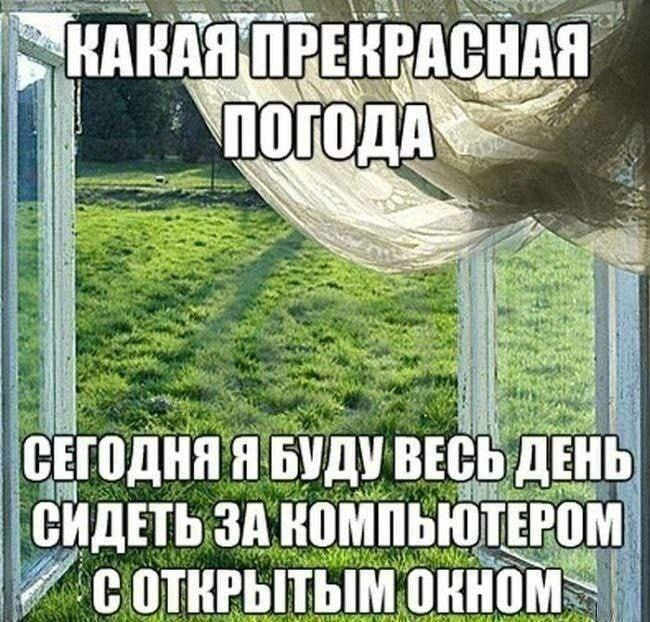

# web6405-kolesnikova_vd
Лабораторные работы по web-программированию

# Лабораторная работа №1

# Информация обо мне

- **ФИО:** Колесникова Виктория Дмитриевна
- **Группа:** 6405
- **Научный руководитель:** уволили.......
- **Тема диплома:** пока отложен по причине сверху

# Любимая цитата 

> «Искусство — самое ужасное преступление».

# Картинка

## Лабораторная работа №2

**Итого:** Сделан многостраничный сайт для приложения медитаций FUSIC на HTML и CSS.

**Структура:**

- about.html - главная страница
- benefits.html - а зачем нам это приложение (плюсы)
- reviews.html - отзывы от самих Милании Трамп (Аня) и Илона Маска (Дима) /имена изменены в целях анонимности/
- faq.html - а зачем нам это приложение v.2 (вопросы ответы)
- pricing.html - сколько стоит 
- css/style.css - единый файл стилей
- images/ - картинки 

**Что реализовано:**

- 5 связанных страниц с общей навигацией
- Шрифт Pangolin (очень захотелось)
- Таблица тарифов
- Единая фиолетовая цветовая палитра
- все по тз в общем есть...

## Лабораторная работа №3

**Суть лабораторной:** Изучение основ JavaScript. Реализованы функции для работы с числами, массивами, рекурсией и замыканиями.

**Итого:** Все 16 тестов матча успешно пройдены.
